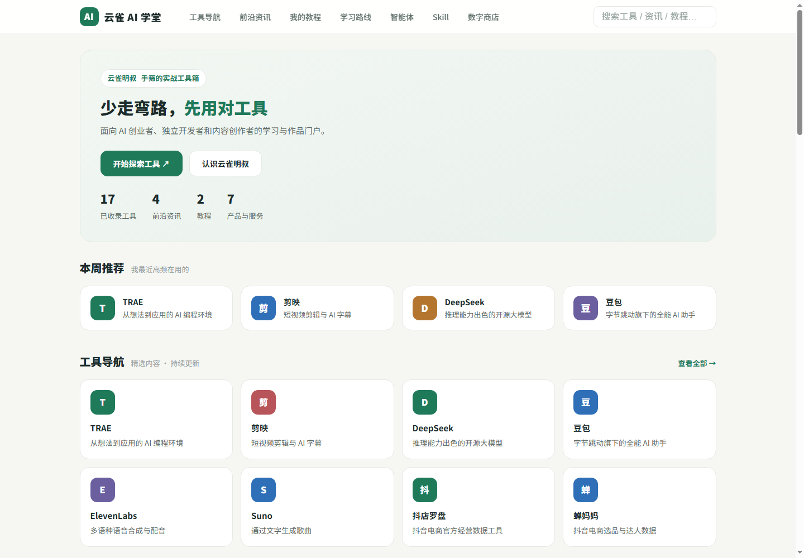
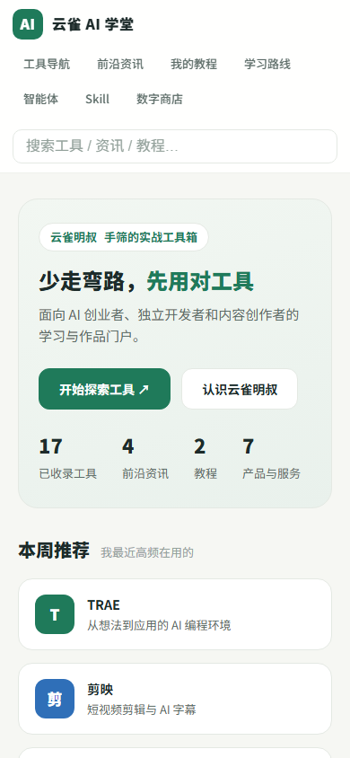
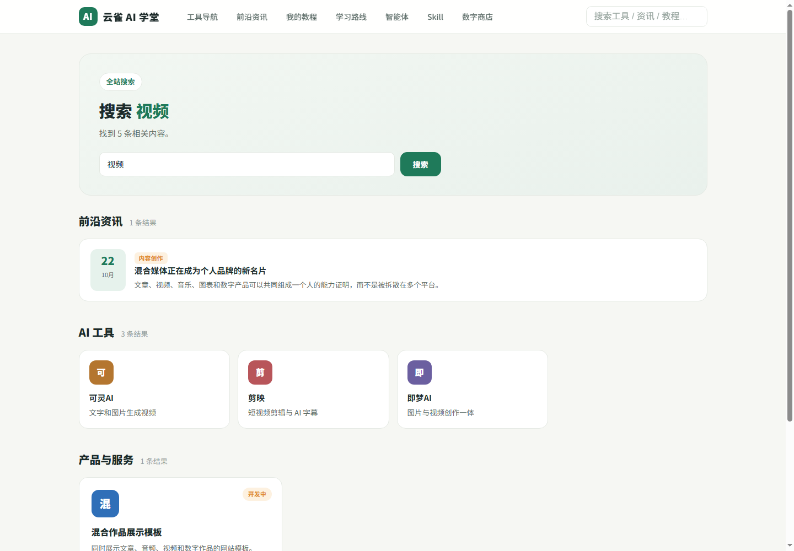
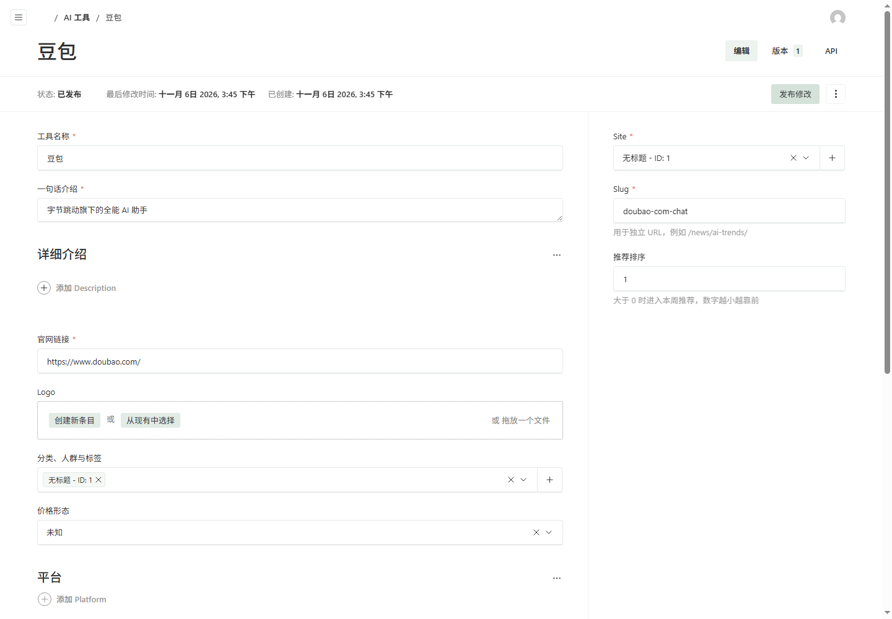

# 云雀 CMS

**面向 AI 创业者、独立创作者和小微企业的轻量混合媒体内容管理系统。**

> **Early Alpha：** 当前版本可以运行和体验，但不建议未经评估直接用于客户生产站点。

云雀 CMS 希望解决一个具体问题：小企业官网和独立创作者作品站，既需要简单的后台和清晰的内容结构，又经常需要发布文章、音频、视频、图表、漫画和数字文件，而传统 CMS 往往过重或内容类型过于单一。

## 产品截图









## 当前能力

- 独立的 Payload 管理后台
- 多站点与站点成员模型
- 后台配置栏目、顺序、导航和首页显示
- 页面、文章、教程、工具、产品、音乐、学习路线、Skill、漫画
- 富文本、图片、图集、视频、音频、图表、漫画阅读器和文件下载
- 草稿与版本记录
- 音频上传和 HTML5 播放器
- 全站搜索
- SEO 字段
- SQLite 本地开发，可切换 PostgreSQL
- 响应式前台

## 为什么做这个项目

我是一个经历过网站、淘宝、农场和工厂的独立创业者。最近开始认真学习 AI 后，我希望把学到的东西变成一个真实、可用、能持续迭代的项目。

云雀 CMS 就是我需要的网站系统：结构清楚、后台独立、能够发布文章、音频、视频和数字产品，同时不引入 WordPress 那样庞大的复杂度。

我选择尽早开源，因为真实反馈比一个人闭门再做一年更有价值。

## 适合谁

- 需要产品官网的 AI 创业者和独立开发者
- 同时发布文章、音频、视频和数字产品的创作者
- 想摆脱 WordPress 复杂度的小微企业
- 想基于 TypeScript 二次开发 CMS 的开发者

## 不适合谁

- 需要成熟插件市场的团队
- 需要复杂编辑部审批流程的大型内容机构
- 需要完整电商、支付、物流和税务系统的商家
- 必须使用自由拖拽页面构建器的用户

## 本地运行

```bash
pnpm install
cp .env.example .env
pnpm seed
pnpm dev
```

访问：

- 前台：<http://localhost:3000>
- 后台：<http://localhost:3000/admin>

默认管理员账号在 `.env` 中设置。请不要把本地演示密码用于正式环境。

## 检查与构建

```bash
pnpm check
pnpm build
pnpm start
pnpm smoke
```

## 技术栈

- Next.js 16
- Payload CMS 3
- React 19
- TypeScript
- SQLite / PostgreSQL
- Sharp

## 开源协议

源代码使用 [MIT License](LICENSE)。

演示内容、音频、截图和品牌名称的授权范围见
[LICENSES.md](LICENSES.md) 和 [TRADEMARK.md](TRADEMARK.md)。

## 反馈

这是一个 Early Alpha 项目。欢迎提交具体的体验问题、使用场景和改进建议。安全漏洞请不要公开提交 Issue，处理方式见 [SECURITY.md](SECURITY.md)。
